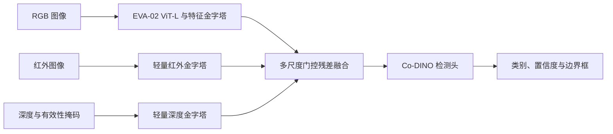

# Multimodal Vision · 多模态视觉识别

面向城市环境的 RGB、红外和深度视觉识别工程。项目基于 Co-DETR 与 EVA-02 ViT-L，将可见光纹理、红外响应和深度几何信息用于同一目标检测网络，提供训练、局部切片、多尺度推理及检测框融合工具。

## 核心功能

- **三模态输入**：按文件名对齐 RGB、红外与深度，构建八通道输入；支持 16 位深度和有效性掩码。
- **逐层残差融合**：以 RGB 特征为主干，使用轻量辅助金字塔和门控残差融合红外与深度信息。
- **分阶段微调**：提供检测头适配、辅助模态适配及红外辅助监督配置。
- **多视图推理**：支持多个输入尺度与水平翻转，以及可配置大小、重叠覆盖的局部切片。
- **框融合与去重**：使用同类别 WBF、IoU 和 IoS 几何约束，输出归一化检测结果。



## 项目结构

```text
configs/          训练、数据管线与模型配置
trifusion/        多模态融合、对齐、辅助监督与框处理
tools/train.py    初始化、训练和完整训练状态恢复
tools/infer.py    多视图、翻转与切片推理
tests/            合成数据与核心算子检查
vendor/Co-DETR/   上游检测框架与许可证
requirements.txt  固定运行依赖
```

## 安装

参考运行环境为 Linux、Python 3.10、PyTorch 1.13.1、CUDA 11.7、MMCV-full 1.7.0。

```bash
bash INSTALL.sh
source .venv/bin/activate
python -m unittest discover -s tests -v
```

安装脚本在项目虚拟环境中应用 deformable-attention FP32 兼容补丁。高分辨率 ViT-L 模型需要足够的主存和 CUDA 显存，推理尺度可通过参数调整。

## 数据组织

每组图像使用相同文件名主干，例如 `sample_001.jpg`、`sample_001.png`，三个模态的几何尺寸一致。图像可以采用 PNG、JPEG 或 BMP；深度优先保留原始 16 位数据。

```text
data/
├── train/{RGB,infrared,depth}/
├── val/{RGB,infrared,depth}/
└── annotations/
    ├── instances_train.json
    └── instances_valid.json
```

标注采用 COCO 格式。数据根目录和标注目录分别由 `TRIMODAL_DATA_ROOT`、`TRIMODAL_ANNOTATION_ROOT` 指定。类别列表与各检测头的 `num_classes` 在配置中保持一致。图像、标注、预训练权重与训练后的模型由使用者自行准备。

## 训练

```bash
export TRIMODAL_DATA_ROOT=/data/multimodal
export TRIMODAL_ANNOTATION_ROOT=/data/multimodal/annotations

python tools/train.py --config configs/rgb.py \
  --init-checkpoint /models/pretrained.pth --work-dir outputs/rgb

python tools/train.py --config configs/fusion.py \
  --init-checkpoint outputs/rgb/latest.pth --work-dir outputs/fusion

python tools/train.py --config configs/infrared_aux.py \
  --init-checkpoint outputs/fusion/latest.pth --work-dir outputs/auxiliary
```

初始化按参数名和形状加载兼容张量，类别数不同的检测头保留初始化状态。`--resume` 恢复同一配置的模型、优化器和 AMP 状态，与 `--init-checkpoint` 分开使用：

```bash
python tools/train.py --config configs/fusion.py \
  --resume outputs/fusion/latest.pth --work-dir outputs/fusion
```

默认配置保留原生检测损失、AMP 和梯度累积；RGB 阶段训练检测部分，融合阶段训练辅助分支及检测部分。红外辅助头用于训练时的直接监督，推理结果来自主检测头。

## 推理

推理数据目录包含 `RGB/`、`infrared/`、`depth/`。模型必须与所选配置具有一致的参数结构和类别定义。

```bash
python tools/infer.py --config configs/fusion.py \
  --data /data/images --checkpoint /models/detector.pth \
  --output outputs/predictions --scales 800 960 1067 1280 \
  --flip --tiles --tile-size 1100 620 --score-thr 0.3
```

四个尺度配合水平翻转形成八视图。切片适配实际图像尺寸，覆盖右侧和下侧边界；切片结果映射回原图后参与同类别去重。带辅助头训练的模型使用 `configs/infrared_aux.py` 加载。输出目录需要使用新目录，运行时逐图打印进度。

每张图像输出一个 TXT，每行依次为：

```text
class_id center_x center_y width height confidence
```

坐标相对整幅图像归一化。无目标时生成空文件；阈值和每图检测数量通过参数设置。

## 检查与验证

```bash
python -m unittest discover -s tests -v
python tools/train.py --help
python tools/infer.py --help
```

测试使用合成图像，检查八通道解码、同步裁剪与翻转、深度掩码、加权框融合、同类几何去重及切片边界覆盖。CPU 测试覆盖数据和后处理逻辑；训练、完整模型前向及其性能需要在配置匹配的 CUDA 环境中验证。

## 第三方组件

检测框架来自 [Sense-X/Co-DETR](https://github.com/Sense-X/Co-DETR)，保留其 MIT 许可证和相关版权声明，见 [vendor/Co-DETR/LICENSE](vendor/Co-DETR/LICENSE)。模型结合 [EVA-02](https://arxiv.org/abs/2303.11331) 视觉主干。上游代码及依赖的授权范围以各自许可证为准。
